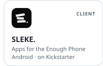

<a href="https://merkost.com"><picture><source media="(prefers-color-scheme: dark)" srcset="assets/v5-header-dark.svg"></picture></a>

I build mobile apps and the servers behind them in Kotlin, and ship them myself.

<a href="https://merkost.com/resume"><picture><source media="(prefers-color-scheme: dark)" srcset="assets/v5-stack-dark.svg"></picture></a>

<a href="https://merkost.com"><picture><source media="(prefers-color-scheme: dark)" srcset="assets/v5-activity-dark.svg"></picture></a>

<a href="https://merkost.com/projects/suby"><picture><source media="(prefers-color-scheme: dark)" srcset="assets/v5-tile-suby-dark.svg"></picture></a><a href="https://github.com/Kimplify"><picture><source media="(prefers-color-scheme: dark)" srcset="assets/v5-tile-kimplify-dark.svg"></picture></a><a href="https://merkost.com/projects/standupbot"><picture><source media="(prefers-color-scheme: dark)" srcset="assets/v5-tile-standupbot-dark.svg"></picture></a><a href="https://merkost.com/projects/sleke"><picture><source media="(prefers-color-scheme: dark)" srcset="assets/v5-tile-sleke-dark.svg"></picture></a>

Writing on ProAndroidDev 
<a href="https://proandroiddev.com/floating-point-cant-hold-a-cent-bigdecimal-can-until-commonmain-0ba3d6c49115">Floating point can't hold a cent. BigDecimal can, until commonMain.</a> 
<a href="https://proandroiddev.com/kpayment-cross-platform-apple-pay-google-pay-for-kotlin-multiplatform-032ebc64ff78">KPayment: Cross-Platform Apple Pay &amp; Google Pay for Kotlin Multiplatform</a> 
<a href="https://proandroiddev.com/type-safe-bottom-navigation-in-jetpack-compose-d18c4d76ac1a">Type Safe Bottom Navigation in Jetpack Compose</a>

<a href="https://merkost.com">&nbsp;merkost.com</a>&nbsp;&nbsp;·&nbsp;&nbsp;<a href="mailto:kosta0212@gmail.com">&nbsp;Email</a>&nbsp;&nbsp;·&nbsp;&nbsp;<a href="https://www.linkedin.com/in/merkost">&nbsp;LinkedIn</a>&nbsp;&nbsp;·&nbsp;&nbsp;<a href="https://medium.com/@merkost">&nbsp;Medium</a>

