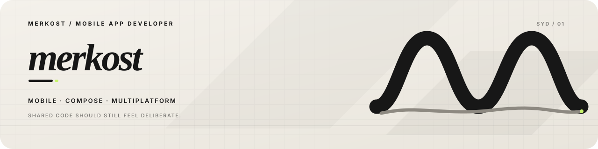

# Hi, I’m Kos.

I build mobile apps under the name **Merkost** — with Compose and Kotlin Multiplatform, based in Sydney.

## Apps

- [Suby](https://subyapp.com) — track subscriptions, renewals and recurring spend.
- [Metronome](https://github.com/Merkost/Metronome) — a focused metronome built with Kotlin Multiplatform and Compose Multiplatform.
- [Fishing Notes](https://github.com/Merkost/FishingNotes) — save fishing spots, log catches and check conditions.
- [Android Drawable Preview](https://github.com/Merkost/Android-drawable-preview-plugin) — rendered drawable previews inside Android Studio and IntelliJ IDEA.

## Kimplify

I maintain [Kimplify](https://github.com/Kimplify), a focused set of Kotlin Multiplatform libraries:

- [Deci](https://github.com/Kimplify/Deci) — precise decimal arithmetic.
- [Kurrency](https://github.com/Kimplify/Kurrency) — type-safe, locale-aware currency formatting.
- [Cedar Logger](https://github.com/Kimplify/Cedar-Logger) — lightweight, extensible logging.
- [KCountries](https://github.com/Kimplify/KCountries) — ISO 3166-1 country data with native names and translations.

## Writing

- [Floating Point Can’t Hold a Cent. BigDecimal Can—Until `commonMain`.](https://medium.com/proandroiddev/floating-point-cant-hold-a-cent-bigdecimal-can-until-commonmain-0ba3d6c49115)
- [KPayment: Cross-Platform Apple Pay & Google Pay for Kotlin Multiplatform](https://proandroiddev.com/kpayment-cross-platform-apple-pay-google-pay-for-kotlin-multiplatform-032ebc64ff78)

## Find me

- [merkost.dev](https://merkost.dev)
- [Portfolio](https://merkost.notion.site/Portfolio-07e5d0d3944548f49f40851fc39e6546)
- [Resume](https://merkost.notion.site/Resume-92d5e73991e54164814dbdacd3106de9)
- [GitHub](https://github.com/Merkost)
- [LinkedIn](https://www.linkedin.com/in/merkost)
- [Telegram](https://t.me/merkost)